<!-- Tema terminal Linux · palet midnight blue. Bagian terminal memakai file di folder assets/ -->

  

  

  
  

  

<code>$ ls -l stack/</code> (klik untuk buka)

 

       

  
  

  

<code>$ git log --graph --since="1 year"</code> (klik untuk buka)

 

  

<code>$ ls ~/trophies</code> (klik untuk buka)

 

  

  

  

<!-- Proudly created with GPRM ( https://gprm.itsvg.in ) -->
